# 🚀 Home Lab & Server-Infrastruktur – Teil 1: Proxmox VE Bare-Metal-Installation

Willkommen zum ersten Teil meiner Dokumentationsreihe zum Aufbau einer eigenen Server- und Virtualisierungsumgebung. In diesem Projekt zeige ich Schritt für Schritt, wie ich einen ausgedienten Laptop in einen leistungsstarken, professionellen Virtualisierungsserver mit **Proxmox Virtual Environment (PVE)** verwandelt habe.

---

## 🗺️ Projekt-Roadmap

- **👉 Teil 1: Proxmox Bare-Metal-Installation (Aktuelles Projekt)**
- **⏳ Teil 2: Infrastructure as Code mit Terraform & Ansible**

---

## 💻 Hardware-Spezifikationen (Server-Basis)

Als Hardware dient ein älterer, repurposed Laptop, der nun als stabiler Heimserver läuft:

- **Modell:** Toshiba Satellite L855-B412
- **Prozessor (CPU):** Intel Core i7-3630QM @ 2.4 GHz
- **Arbeitsspeicher (RAM):** Aufgerüstet auf 12 GB DDR3
- **Speicher (Storage):** 500 GB HDD/SSD
- **Netzwerk:** Ethernet-Kabel (LAN) – _Hinweis: WLAN wird für Server-Installationen aufgrund von Stabilität und Treiber-Einschränkungen nicht empfohlen._

---

## 📋 Systemvoraussetzungen & Offizielle Links

Vor dem Start sollten die offiziellen Hardwarerichtlinien geprüft werden:

- [Proxmox VE System Requirements](https://www.proxmox.com/en/products/proxmox-virtual-environment/requirements)
- [Proxmox VE ISO Downloads](https://www.proxmox.com/en/downloads/proxmox-virtual-environment/iso)
- [Rufus (Bootable USB Tool)](https://rufus.ie/de/)

---

## 🛠️ Schritt-für-Schritt-Installationsanleitung

### 1. Vorbereitung des Boot-Mediums

1. Lade das offizielle **Proxmox VE ISO-Image** für Intel-CPUs herunter.

   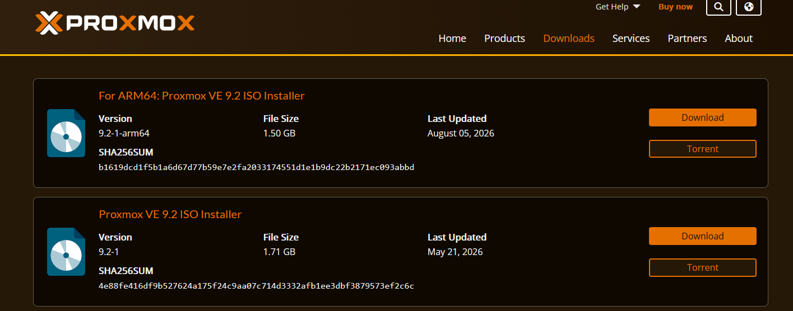

2. Lade das Tool **Rufus** (`rufus-4.15.exe`) herunter und flashe das ISO-Image auf einen USB-Stick, um ein bootfähiges Installationsmedium zu erstellen.

   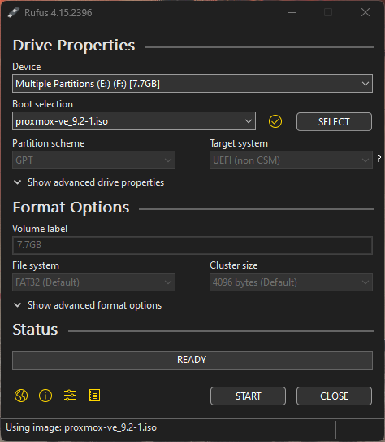

---

### 2. BIOS / UEFI Setup & Installation starten

- Schließe den USB-Stick an den Laptop an und starte ihn neu.
- Drücke wiederholt die entsprechende Taste (z.B. `Entf`, `F12` oder `F11`, abhängig vom Laptop-Modell), um in das Boot-Menü zu gelangen, und wähle den USB-Stick aus.

---

### 3. Proxmox Installer Durchführung

- **EULA & Lizenzvereinbarung:** Bestätige die Nutzungsbedingungen, um fortzufahren.

  

- **Ziel-Festplatte:** Wähle die Hauptfestplatte aus. _Achtung: Dies löscht alle Daten auf der Festplatte vollständig!_

  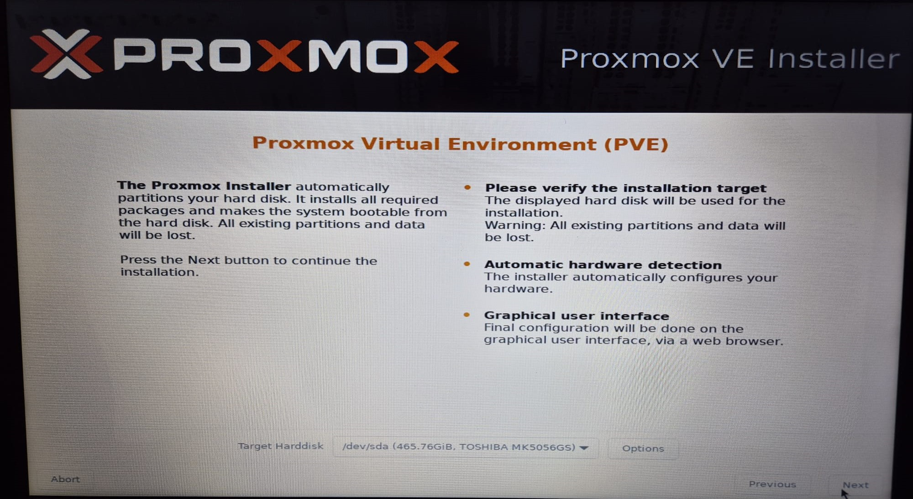

- **Land & Zeitzone:** Trage dein Land (z.B. Deutschland) und die Zeitzone ein.

  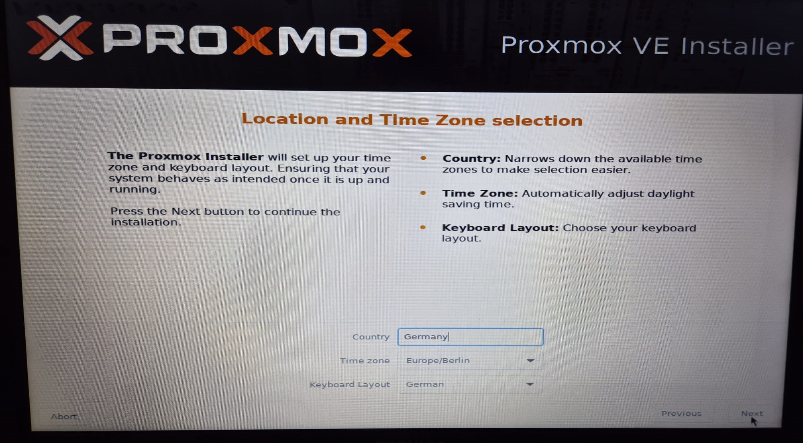

- **Admin-Anmeldedaten:** Vergib ein sicheres Root-Passwort und trage eine gültige E-Mail-Adresse für Systembenachrichtigungen ein.

  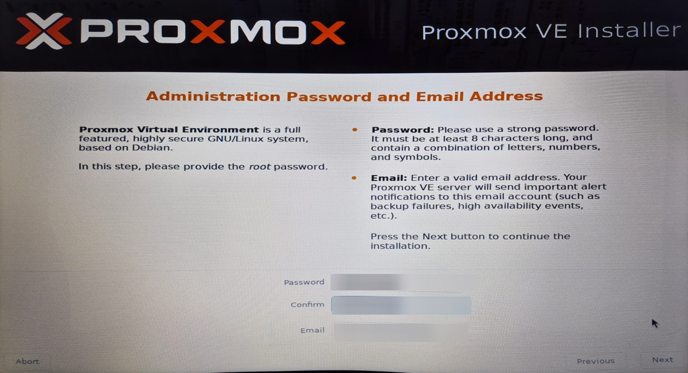

---

### 4. Netzwerkkonfiguration (Best Practice: Statisches IPv4)

> 💡 **Wichtiger Hinweis zum Netzwerk:** Der Installer zieht standardmäßig oft automatisch IPv6-Adressen. Für einen Server ist es jedoch Best Practice, eine **statische IPv4-Adresse** zu vergeben, damit du den Server im Heimnetzwerk immer unter derselben IP-Adresse über den Browser erreichen kannst.
>
> _Tipp zur Ermittlung deines Gateways & DNS:_ Öffne auf deinem Windows-Desktop die Eingabeaufforderung (`cmd`) und tippe `ipconfig /all` ein. Dort siehst du dein Standardgateway und deinen DNS-Server.

- Konfiguriere das Netzwerk mit Hostnamen, statischer IPv4-Adresse (inklusive CIDR wie `/24` für Heimnetze), Gateway und DNS.

  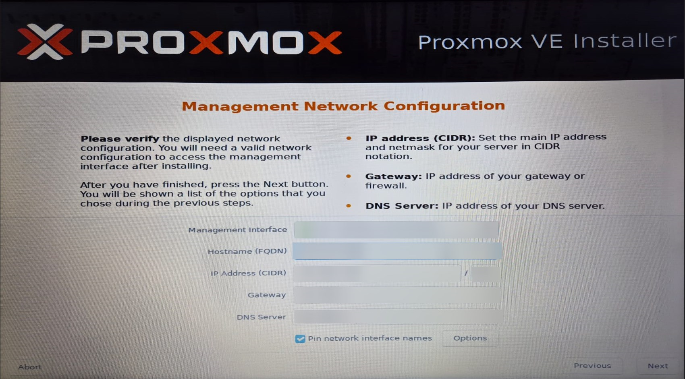

- **Installations-Zusammenfassung:** Überprüfe alle Einstellungen und starte die Installation.

  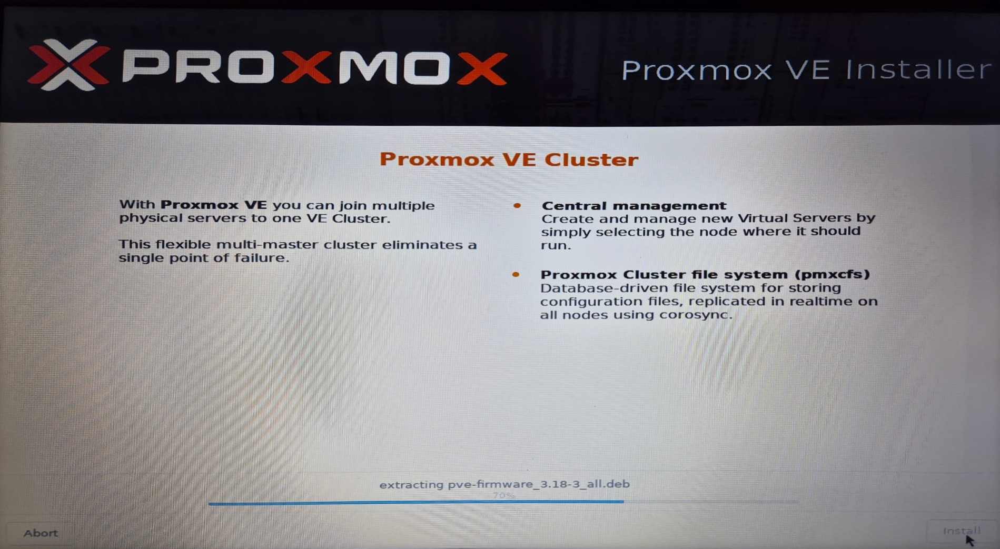

---

## 🖥️ Erster Login & Web-Interface

Nach erfolgreicher Installation startet der Server neu. Du siehst auf dem Laptop-Bildschirm die Zugriffs-URL (z. B. `https://<deine-ip>:8006`).

1. Öffne den Browser auf deinem Hauptcomputer und rufe die IP-Adresse mit dem Port `8006` auf.
2. Logge dich mit dem Benutzernamen `root` und deinem vergebenen Passwort ein.

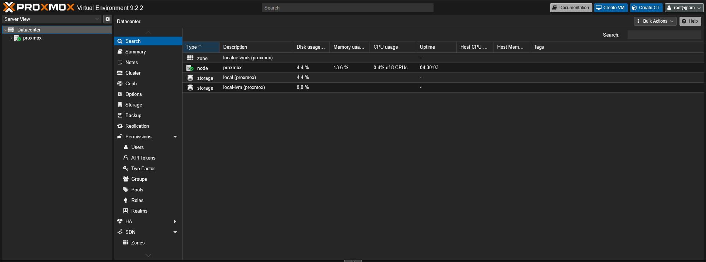

---

## 💾 Speicher-Optimierung (LVM-Storage zusammenlegen)

Standardmäßig teilt Proxmox den Festplattenspeicher auf (`local` für ISOs/Container und `local-lvm` für VMs). Da wir den gesamten Speicherplatz flexibel nutzen möchten, führen wir die Partitionen zusammen.

1. **Prüfen des Speichers:** Ansicht des bisher aufgeteilten Speichers.

   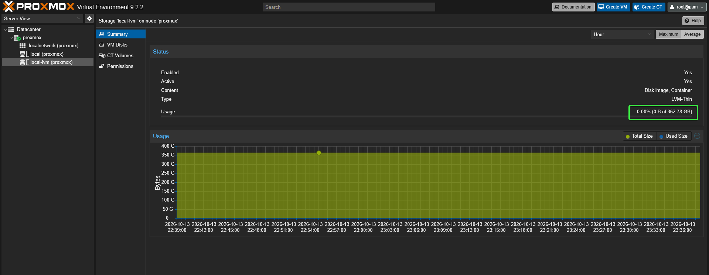
   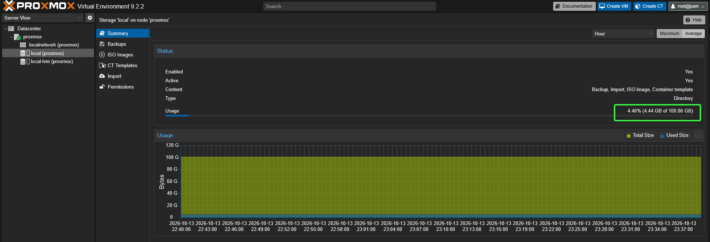

2. **Entfernen von `local-lvm`:** Entferne den `local-lvm`-Eintrag im Web-Interface.

   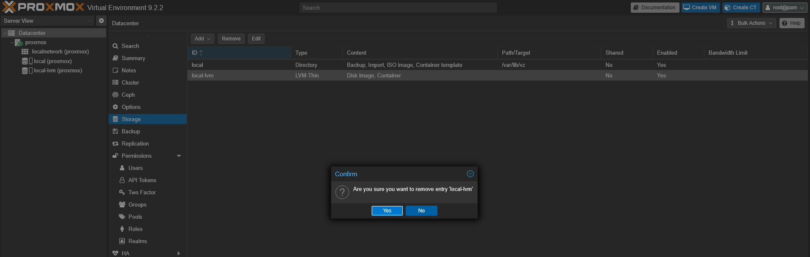

3. **Shell-Befehle zur Zusammenführung:**
   Öffne die Proxmox-Shell im Web-Interface und führe nacheinander folgende Befehle aus:

   ```bash
   lvremove /dev/pve/data
   # Bestätige die Sicherheitsabfrage mit 'y'
   lvresize -l +100%FREE /dev/pve/root
   resize2fs /dev/mapper/pve-root
   ```

   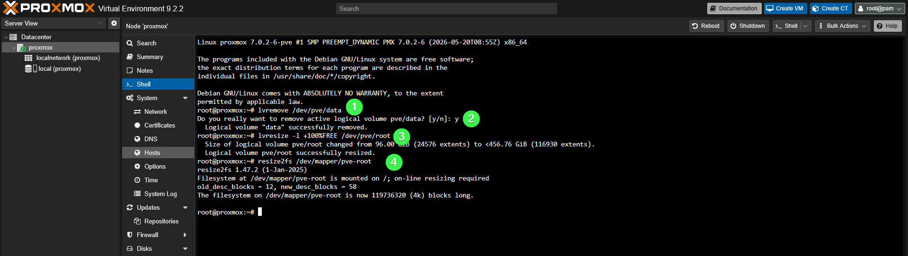

4. **Ergebnis:** Der gesamte Speicher steht nun uneingeschränkt zur Verfügung.

   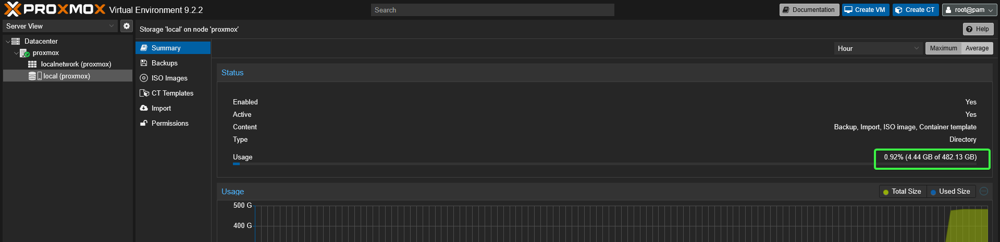

5. **ISO & Container Berechtigungen:** Aktiviere im local-Speicher die Berechtigungen für ISO-Images und Container-Templates, damit du direkt Images hochladen kannst.

   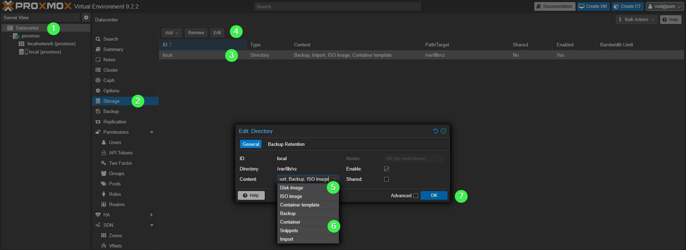

## 🔋 Laptop-Spezifische Anpassungen (Headless-Betrieb)

Da dieses Projekt auf einem Laptop läuft, möchten wir ihn zukünftig zugeklappt und ohne angeschlossenen Monitor betreiben, ohne dass er in den Energiesparmodus wechselt oder der Bildschirm unnötig Strom verbraucht.

### 1. Laptop-Deckel schließen verhindern (Kein Standby)

Öffne die Shell und bearbeite die Konfigurationsdatei:

```bash
nano /etc/systemd/logind.conf
```

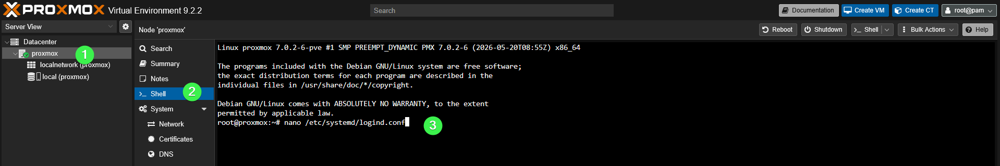

Passe folgende Zeilen an (entferne ggf. das `#` am Anfang):

```ini
HandleLidSwitch=ignore
HandleLidSwitchDocked=ignore
```

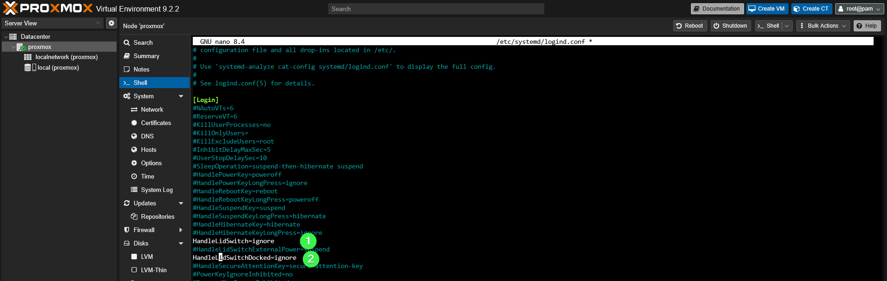

Starte den Service neu, um die Änderung zu übernehmen:

```bash
systemctl restart systemd-logind.service
```

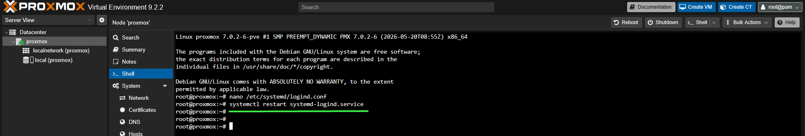

### 2. Bildschirm-Timeout (Display automatisch abschalten)

Da wir den Laptop-Bildschirm im Server-Betrieb nicht brauchen, schalten wir ihn nach kurzer Zeit automatisch ab:

```bash
nano /etc/default/grub
```

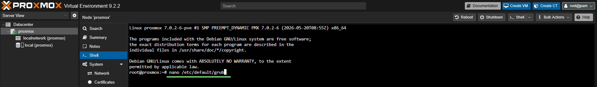

Füge in der Zeile `GRUB_CMDLINE_LINUX` den Parameter `consoleblank=200` hinzu:

```plaintext
GRUB_CMDLINE_LINUX="consoleblank=200"
```

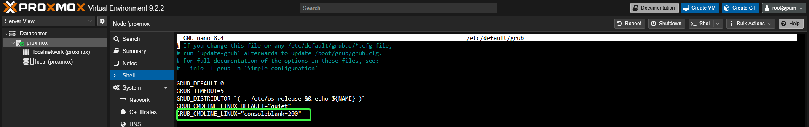

Aktiviere die Grub-Änderung im System:

```bash
update-grub
```

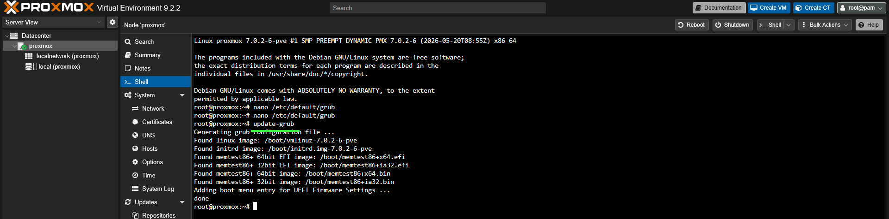

## 🎯 Nächste Schritte

Damit ist die grundlegende Installation und Hardware-Optimierung unseres Proxmox-Heimservers abgeschlossen!

In **Teil 2** werden wir diesen Server mit **Terraform** zur automatisierten Bereitstellung von VMs (Infrastructure as Code) und **Ansible** zum Konfigurationsmanagement erweitern.

_Dokumentiert und umgesetzt von **Mohamad Issa**_
